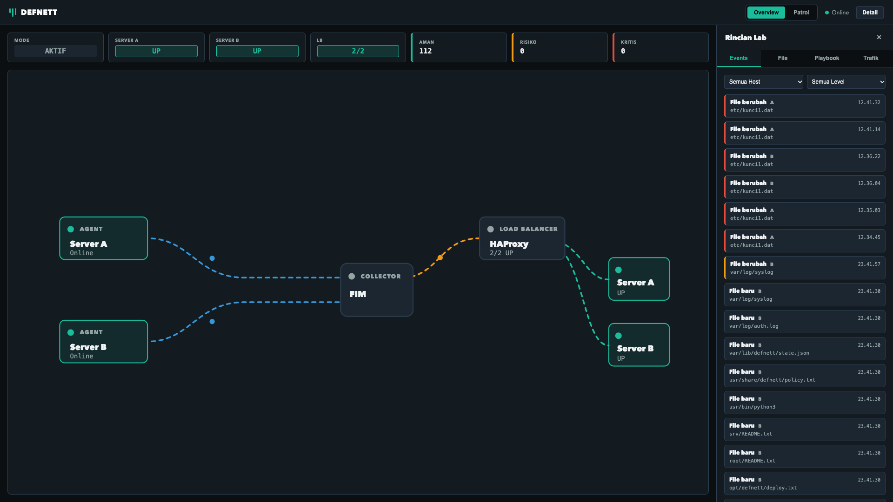
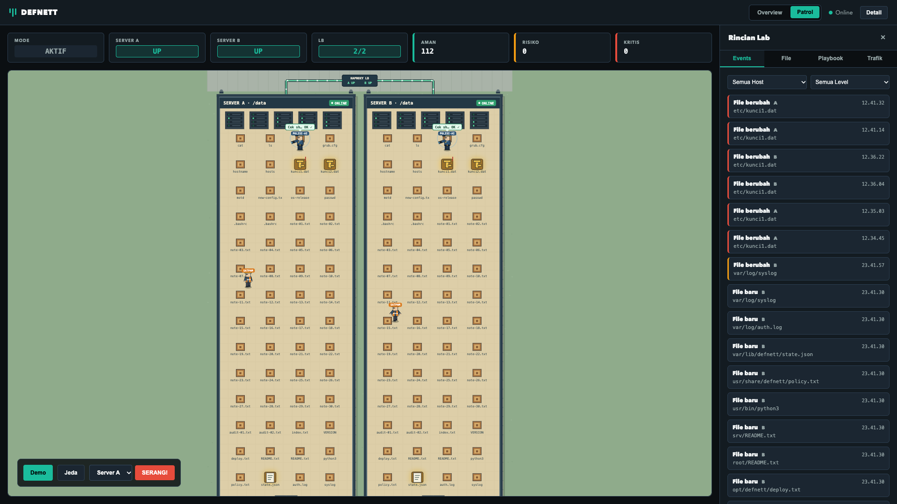
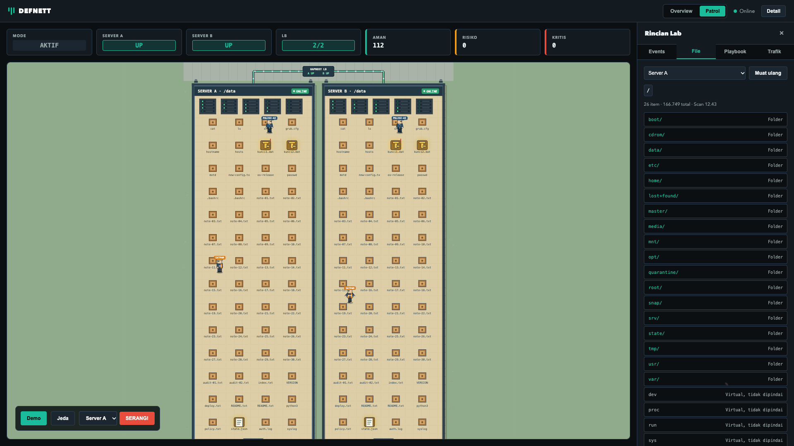
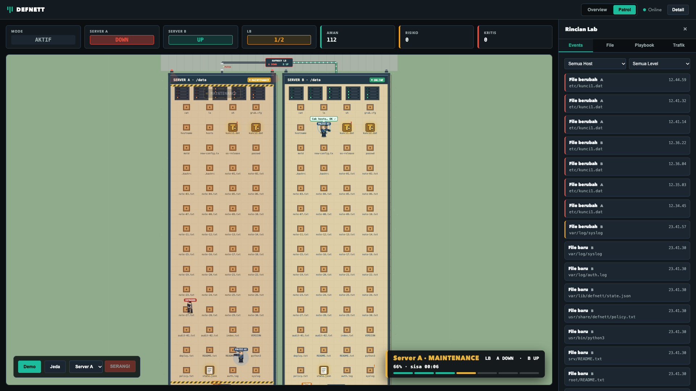
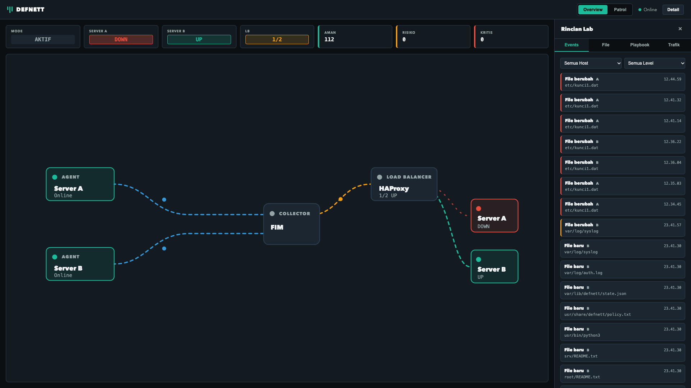
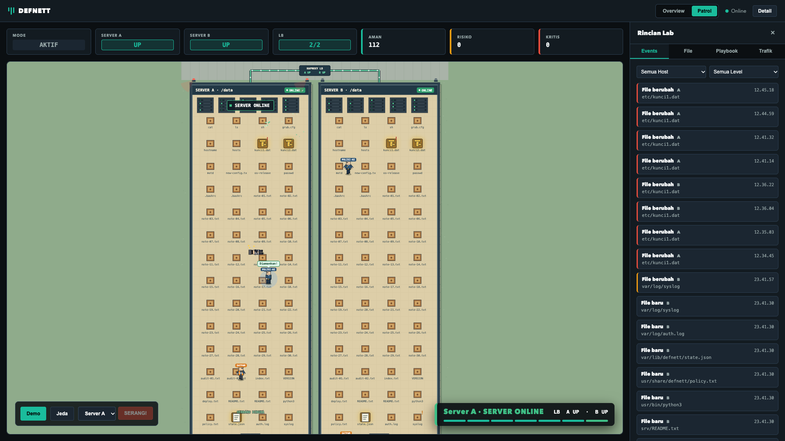

# DEFNETT

Lab pertahanan siber dua server di balik load balancer. Agent memantau integritas file, collector menilai risiko, dan saat file penting diubah, server target dikeluarkan dari HAProxy, dipulihkan, lalu dimasukkan kembali, sementara situs tetap melayani lewat server lainnya.

## Arsitektur

| VM | Alamat | Peran |
|---|---|---|
| Gateway | `192.168.56.10` | HAProxy, port 8080 |
| Server A | `192.168.56.11` | App, agent FIM, remediator |
| Server B | `192.168.56.12` | App, agent FIM, remediator |
| Collector | `192.168.56.20` | Collector dan dashboard, port 8090 |

## Tampilan

Overview:

Patrol:

Tab File, menampilkan file system tiap server per folder:

Saat **Serang!** ditekan, Server A keluar dari HAProxy dan trafik pindah ke Server B:

Setelah file dipulihkan dan health check lolos, Server A kembali ke rotasi:

## Dokumentasi

Cara menjalankan dan detail teknis ada di [lab/README.md](lab/README.md). Konfigurasi VM ada di [lab/vm](lab/vm).

Proyek ini hanya untuk lab terisolasi. Berkas `kunci1.dat` dan `kunci2.dat` adalah data contoh, dan skor risiko berbasis aturan, bukan model AI terlatih.
