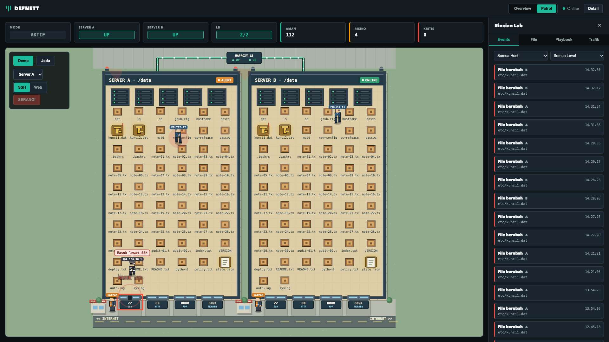
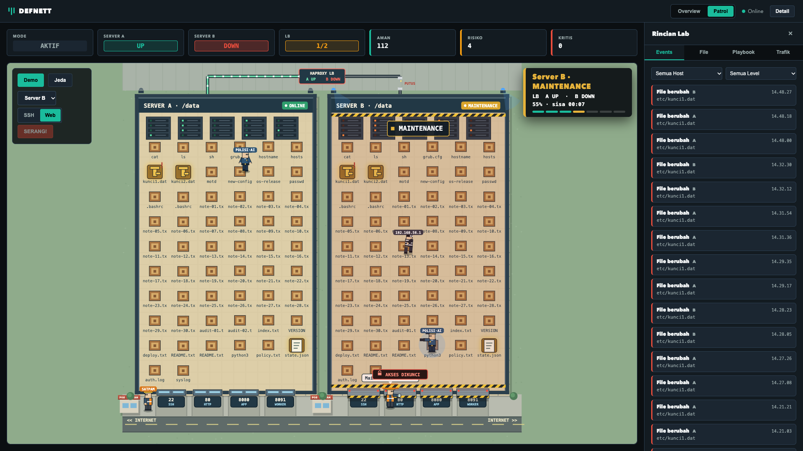
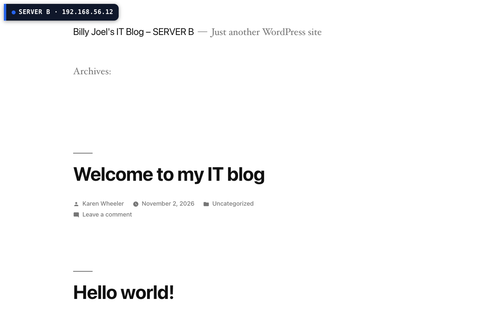

# DEFNETT

Lab pertahanan siber dua server di balik load balancer. Agent memantau integritas file, collector menilai risiko, dan saat file penting diubah, server target dikeluarkan dari HAProxy, dipulihkan, lalu dimasukkan kembali, sementara situs tetap melayani lewat server lainnya.

## Arsitektur

| VM | Alamat | Peran |
|---|---|---|
| Gateway | `192.168.56.10` | HAProxy, port 8080 |
| Server A | `192.168.56.11` | App, agent FIM, remediator |
| Server B | `192.168.56.12` | App, agent FIM, remediator |
| Collector | `192.168.56.20` | Collector dan dashboard, port 8090 |

## Tampilan

Overview:

Patrol. Jumlah pintu tiap server mengikuti port yang benar-benar terbuka (`22 SSH`, `80 HTTP`, `8080 APP`, `8091 WORKER`):

Tab File, menampilkan file system tiap server per folder:

Tombol **Serang!** punya pilihan jalur **SSH** atau **Web**. Dengan jalur SSH, intruder masuk lewat pintu 22:

Setelah file kunci diubah, Server A keluar dari HAProxy dan trafik pindah ke Server B:

Setelah file dipulihkan dan health check lolos, Server A kembali ke rotasi:

Dengan jalur Web, intruder masuk lewat pintu 80, dan Server B yang keluar dari rotasi:

## Situs yang dilayani

Kedua server melayani blog WordPress di port 80, dan HAProxy membagi trafik ke keduanya. Setiap halaman memuat lencana serta judul **SERVER A** atau **SERVER B**, sehingga server yang menjawab langsung terlihat.

Konfigurasi gateway ada di [lab/vm/gateway/haproxy.cfg](lab/vm/gateway/haproxy.cfg). WordPress 5.0 memerlukan satu perbaikan agar halaman daftar tulisan tampil di PHP 8, yaitu [lab/vm/fix-wp-php8-home.sh](lab/vm/fix-wp-php8-home.sh).

## Catatan keamanan

Lab ini sengaja dibuat rentan dan **hanya untuk jaringan lab yang terisolasi**.

- **Perangkat lunak lama:** blog memakai WordPress 5.0, versi lama yang memiliki kerentanan publik yang sudah diketahui. Versi itu dipilih karena tujuan lab ini adalah mengamati deteksi dan respons terhadap serangan, bukan menjaga situs tetap aman.
- **Data contoh:** `kunci1.dat` dan `kunci2.dat`, akun blog, dan seluruh isi `/data` adalah data buatan, bukan data nyata.
- **Jangan dipasang di jaringan publik:** jangan dibuka ke internet dan jangan diisi data pribadi. Jaringan antar VM memakai host-only, dan firewall tiap VM hanya mengizinkan lalu lintas yang diperlukan.
- **Skor risiko berbasis aturan:** penilaian di dashboard bukan model AI terlatih, dan tombol **Serang!** hanya mengubah file kunci demo di server lab.

## Rencana pengembangan

Jika lolos ke babak selanjutnya, kami akan:

- **Membuat model ML untuk skor risiko**, agar penilaian lebih akurat daripada skor berbasis aturan yang dipakai sekarang.
- **Membatasi Polisi AI (agent FIM) ke izin read-only**, sehingga agent hanya bisa membaca dan memantau file.
- **Membatasi Satpam (remediator) ke izin execute dan write saja**, sehingga Satpam hanya menjalankan perbaikan dan menulis file pemulihan.

## Dokumentasi

Cara menjalankan dan detail teknis ada di [lab/README.md](lab/README.md). Konfigurasi VM ada di [lab/vm](lab/vm).

Proyek ini hanya untuk lab terisolasi. Berkas `kunci1.dat` dan `kunci2.dat` adalah data contoh, dan skor risiko berbasis aturan, bukan model AI terlatih.
